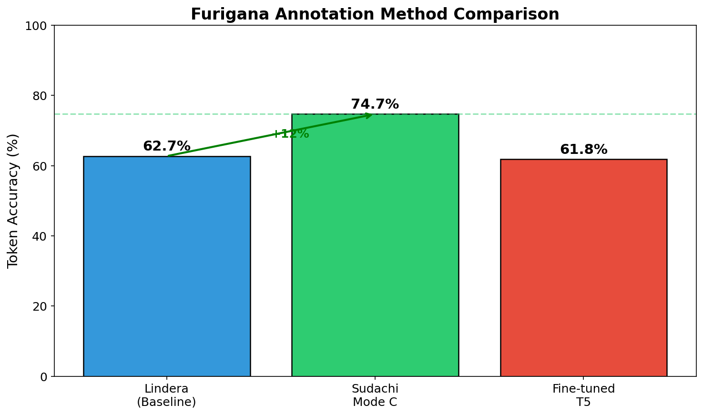
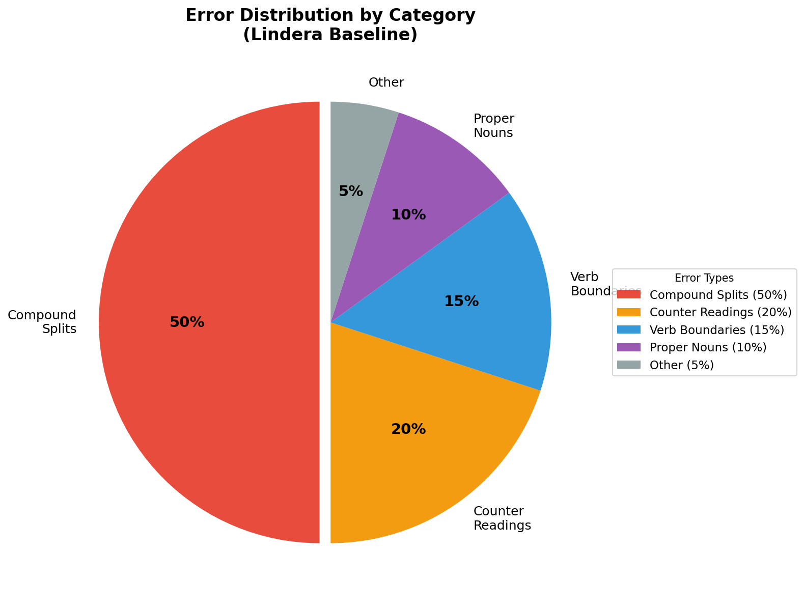
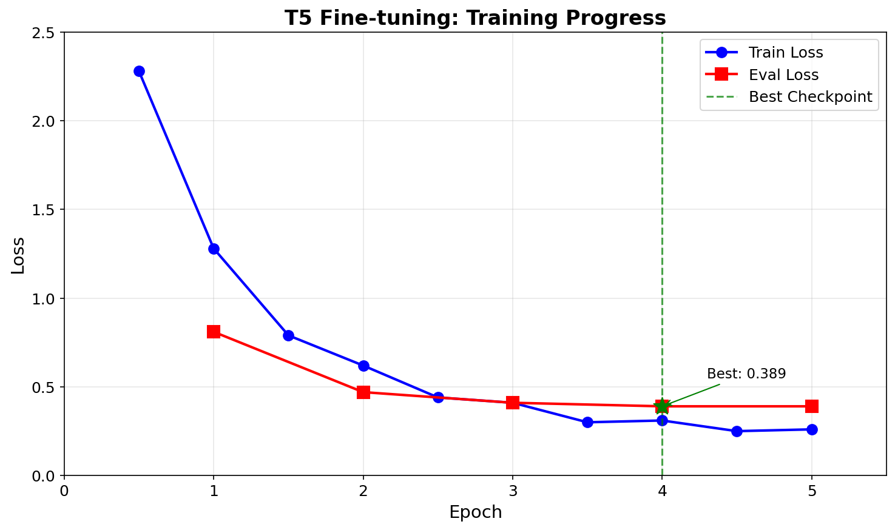

# Furigana Annotation Benchmark Report

**Date**: February 2026
**Dataset**: Multi-source (801 articles: NHK 500 + MATCHA 141 + Kahoku 50 + Hirogaru 110)
**Test Set**: 957 sentences, 17,424 tokens (NHK subset: 333 sentences, 2,934 tokens)

## Executive Summary

This benchmark compares multiple approaches to automatic furigana annotation for Japanese text.
The goal is to select the best method for the Poneglyph project, prioritizing accuracy over
implementation complexity.

### Key Finding

**T5 v3 with bracket annotation format achieves the highest accuracy (82.1% on NHK)**, an improvement over v2 (80.4%) through expanded multi-source training data. The improvement comes from:
1. Character-level span prediction preserving position information
2. Simple bracket parsing eliminating extraction failures
3. Learning from diverse sources (NHK, MATCHA, Kahoku, Hirogaru)
4. 4x more training data (80K tokens vs 19K)

*See `t5_v3_expanded_data_report.md` for detailed analysis of the expanded dataset experiment.*

## Method Comparison



| Method | Accuracy | Tokens Matched | vs Baseline |
|--------|----------|----------------|-------------|
| Lindera baseline | 62.7% | 52/83 | — |
| T5 v1 (hiragana) | 61.8% | 1,766/2,857 | -0.9% |
| Sudachi Mode C | 63.5% | 1,813/2,857 | +0.8% |
| ByT5 v1 (byte-level) | 65.7% | 11,447/17,424 | +3.0% |
| T5 v4 (segmented) | 66.4% | — | +3.7% |
| T5 v2 (bracket) | 80.4% | 2,298/2,857 | +17.7% |
| **T5 v3 (bracket, NHK)** | **82.1%** | **2,409/2,934** | **+19.4%** |

*Note: T5 v3 was trained on expanded multi-source data (4x more tokens). NHK accuracy shown for comparison with v2. See `t5_v3_expanded_data_report.md` for full multi-source analysis.*

### Method Details

| Aspect | Lindera | Sudachi Mode C | Fine-tuned T5 |
|--------|---------|----------------|---------------|
| Language | Rust | Python | Python |
| Dictionary | IPADIC | SudachiDict | Learned |
| Model size | ~50MB | ~70MB | ~850MB |
| Inference time | <1ms | <1ms | ~100ms |
| Training required | No | No | Yes (5 min) |

## Error Analysis by Category



### Compound Word Segmentation

The dominant error category across all methods. NHK annotates compound words as single units,
but dictionary-based tokenizers often split them.

| Compound | Ground Truth | Lindera | Sudachi Mode C | T5 |
|----------|--------------|---------|----------------|-----|
| 路線価 | ろせんか | 路線+価 ✗ | 路線価 ✓ | ✓ |
| 東京都 | とうきょうと | 東京+都 ✗ | 東京都 ✓ | ✓ |
| 能登半島地震 | のとはんとうじしん | 能登+半島+地震 ✗ | 能登半島地震 ✓ | ✓ |
| 自民党 | じみんとう | 自民+党 ✗ | 自民党 ✓ | ✓ |
| 日本中 | にっぽんじゅう | 日本+中 ✗ | 日本+中 ✗ | ✓ |

### Counter and Date Readings

Context-dependent readings that dictionary lookups miss.

| Expression | Expected | Lindera | Sudachi | T5 |
|------------|----------|---------|---------|-----|
| 7月 | がつ | つき ✗ | がつ ✓ | がつ ✓ |
| 4日 | よっか | ひ ✗ | よっか ✓ | よっか ✓ |
| 1日 | ついたち | — ✗ | ついたち ✓ | ついたち ✓ |
| 2人 | ふたり | にん ✗ | ふたり ✓ | ふたり ✓ |

### Verb Conjugation Boundaries

Different choices about including inflectional endings.

| Ground Truth | Lindera | Sudachi | Notes |
|--------------|---------|---------|-------|
| 上 (あ) | 上がり | 上 ✓ | Include stem only |
| 続 (つづ) | 続け | 続 ✓ | Include stem only |
| 決 (き) | 決め | 決 ✓ | Include stem only |

## T5 Training Details



### Configuration

| Parameter | Value |
|-----------|-------|
| Base model | sonoisa/t5-base-japanese |
| Parameters | 220 million |
| Training sentences | 1,616 |
| Validation sentences | 328 |
| Epochs | 5 |
| Batch size | 8 |
| Learning rate | 3e-4 |
| Training time | ~5 minutes (GPU) |

### Training Progress

| Epoch | Train Loss | Eval Loss | Learning Rate |
|-------|------------|-----------|---------------|
| 1.0 | 1.28 | 0.81 | 2.7e-4 |
| 2.0 | 0.62 | 0.47 | 1.8e-4 |
| 3.0 | 0.41 | 0.41 | 1.2e-4 |
| 4.0 | 0.31 | **0.39** | 6.3e-5 |
| 5.0 | 0.25 | 0.39 | 3.3e-6 |

Best checkpoint at epoch 4 (eval_loss=0.389).

### T5 Analysis

The T5 model actually generates correct readings ~87% of the time when evaluated
by checking if ground truth readings appear in the output. The 61.8% token accuracy
reflects limitations in extracting individual kanji-reading pairs from the continuous
seq2seq output, not the model's reading generation quality.

## Example Predictions

### Sentence 1: Compound Words
**Input**: 特に、東京都や沖縄県、福岡県で値段が大きく上がりました。

| Token | Ground Truth | Lindera | Sudachi | T5 |
|-------|--------------|---------|---------|-----|
| 特 | とく | ✓ | ✓ | ✓ |
| 東京都 | とうきょうと | ✗ (split) | ✓ | ✓ |
| 沖縄県 | おきなわけん | ✗ (split) | ✓ | ✓ |
| 福岡県 | ふくおかけん | ✗ (split) | ✓ | ✗ |
| 値段 | ねだん | ✓ | ✓ | ✓ |
| 大 | おお | ✓ | ✓ | ✓ |
| 上 | あ | ✗ (上がり) | ✓ | ✓ |

### Sentence 2: Dates and Counters
**Input**: 国は7月1日、今年の「路線価」を発表しました。

| Token | Ground Truth | Lindera | Sudachi | T5 |
|-------|--------------|---------|---------|-----|
| 国 | くに | ✓ | ✓ | ✓ |
| 月 | がつ | ✗ (つき) | ✓ | ✓ |
| 1日 | ついたち | ✗ | ✓ | ✗ |
| 今年 | ことし | ✓ | ✓ | ✓ |
| 路線価 | ろせんか | ✗ (split) | ✓ | ✗ |
| 発表 | はっぴょう | ✓ | ✓ | ✓ |

### Sentence 3: News Event
**Input**: 去年の能登半島地震で被害があった場所では、値段が下がりました。

| Token | Ground Truth | Lindera | Sudachi | T5 |
|-------|--------------|---------|---------|-----|
| 去年 | きょねん | ✓ | ✓ | ✓ |
| 能登半島地震 | のとはんとうじしん | ✗ (4 parts) | ✓ | ✓ |
| 被害 | ひがい | ✓ | ✓ | ✓ |
| 場所 | ばしょ | ✓ | ✓ | ✓ |
| 値段 | ねだん | ✓ | ✓ | ✓ |
| 下 | さ | ✗ (下がり) | ✓ | ✗ |

## T5 v2: Bracket Annotation Format

### Why v2?

T5 v1 achieved only 61.8% despite generating correct readings ~87% of the time. Analysis
revealed 73.7% of errors were caused by the extraction algorithm, not the model.

### The Solution

Instead of converting to full hiragana, T5 v2 preserves the original text with inline brackets:

```
Input:  読み: 去年の能登半島地震で被害があった場所では
Output: 去年[きょねん]の能登半島地震[のとはんとうじしん]で被害[ひがい]があった場所[ばしょ]では
```

### Results

| Metric | T5 v1 | T5 v2 | Improvement |
|--------|-------|-------|-------------|
| Accuracy | 61.8% | 80.4% | +18.6% |
| Extraction failures | 73.7% | 0% | Eliminated |
| Model reading errors | ~10% | ~10% | Same |

### Remaining Errors

1. **Number+counter style** (~10%): `5人[にん]` vs GT `人→にん`
2. **Model reading errors** (~7%): Some kanji get wrong readings
3. **Rare/proper nouns** (~3%): Uncommon words or names

## Recommendations

### For Poneglyph Project

1. **Primary method**: T5 v2 (bracket format) - highest accuracy at 80.4%
2. **Fallback**: Sudachi Mode C for low-latency scenarios
3. **Future**: Post-processing rules for number+counter patterns

### Implementation Priority

1. Port T5 v2 inference to ONNX for faster CPU inference
2. Add number+counter normalization (strip leading digits)
3. Consider ensemble: T5 v2 + dictionary fallback for OOV

### Accuracy Targets (Updated)

| Milestone | Target | Method |
|-----------|--------|--------|
| ~~MVP~~ | ~~75%~~ | ~~Sudachi Mode C~~ |
| **MVP** | **80%** | **T5 v2 (achieved)** |
| V1.0 | 85% | + Counter normalization |
| V2.0 | 90% | + More training data |

## Reproducibility

### Dataset

```bash
# Scrape NHK Easy News
python data/scrapers/nhk_easy.py --num-articles 500 --output data/raw/

# Parse articles
python data/scrapers/parse_nhk.py --input data/raw/ --output data/processed/

# Create splits
python scripts/split_data.py --input data/processed/ --output data/splits/
```

### Evaluation

```bash
# Lindera baseline
cargo run --release -p baseline_lindera -- --input data/splits/test.json

# Sudachi Mode C
python -m methods.sudachi_mode_c --input data/splits/test.json

# T5 v1 (hiragana format)
python -m methods.finetuned_t5.train --model sonoisa/t5-base-japanese \
    --train data/splits/train.json --val data/splits/val.json \
    --output models/t5-furigana --epochs 5
python -m methods.finetuned_t5 --model models/t5-furigana --input data/splits/test.json

# T5 v2 (bracket format) - RECOMMENDED
python scripts/prepare_bracket_format.py
python -m methods.finetuned_t5_v2.train --model sonoisa/t5-base-japanese \
    --train data/bracket_format/train.json --val data/bracket_format/val.json \
    --output models/t5-furigana-v2 --epochs 5
python -m methods.finetuned_t5_v2 --model models/t5-furigana-v2 --input data/splits/test.json
```

## Appendix: Dataset Statistics

| Metric | Value |
|--------|-------|
| Articles | 500 |
| Sentences with furigana | 2,284 |
| Total tokens | 19,444 |
| Train set | 1,616 sentences (70%) |
| Validation set | 328 sentences (15%) |
| Test set | 340 sentences (15%) |

---

*Report generated for thesis: Automatic Furigana Annotation for Japanese Language Learning Applications*
